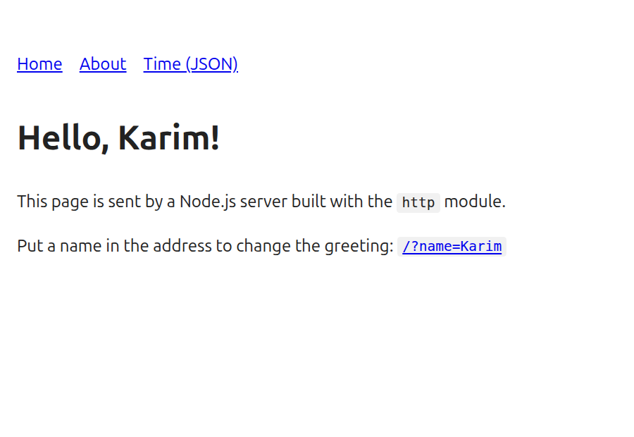
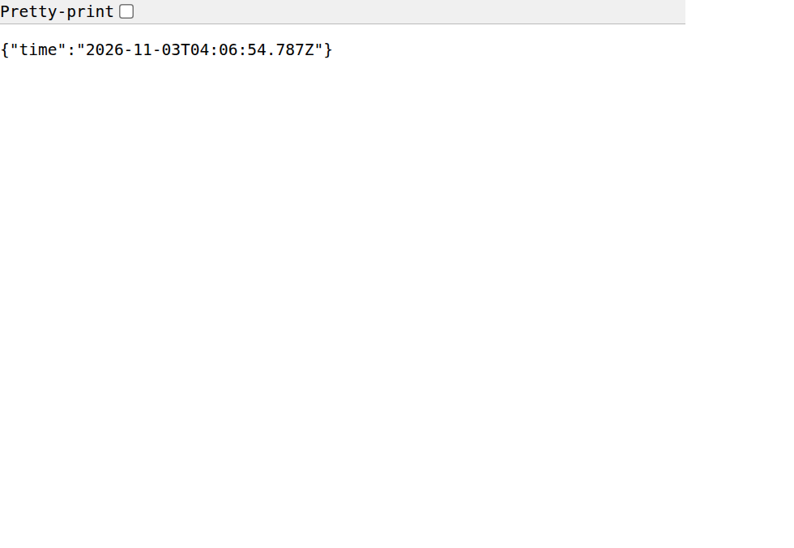
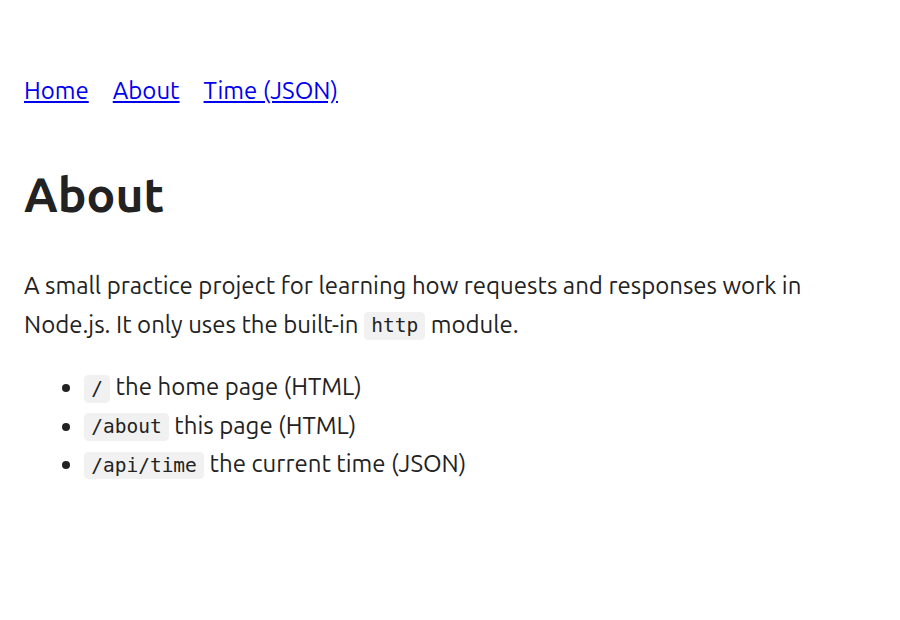

# Node HTTP Server

A small practice server built with the built-in `http` module of Node.js. There is no Express and there are no dependencies. It sends HTML pages and JSON, shows a 404 page, greets a visitor by `?name=` and prints every request in the terminal.

## Run it

```bash
git clone https://github.com/JFJubayer/node-http-server.git
cd node-http-server
npm start
```

Open http://localhost:3000 in a browser and stop the server with `Ctrl+C`. There is nothing to install. Needs Node.js 20 or newer (tested on Node 22).

Optional settings: `PORT` (default `3000`) and `HOST` (default `127.0.0.1`, so only your own computer can connect). Example: `PORT=4000 npm start`.

## Routes

| Path | Answer | Notes |
| --- | --- | --- |
| `/` | HTML page | `/?name=Karim` greets Karim. Without a name it says "Hello, world!" |
| `/about` | HTML page | What this project is |
| `/api/time` | JSON | The current time, like `{"time":"2026-11-03T04:06:32.839Z"}` |
| anything else | HTML 404 page | Status `404` |

Only `GET` and `HEAD` are allowed. Other methods get `405 Method Not Allowed`. The name is escaped before it goes into the page, so `?name=<script>` is shown as text and never runs.

## Screenshots

Taken in a browser while the server was running.

`http://localhost:3000/?name=Karim`



`http://localhost:3000/api/time`



`http://localhost:3000/about` and `http://localhost:3000/nope`




## Request log

Every request is printed in the terminal with the time, method, address, status code and how long it took:

```text
2026-11-03T04:05:22.634Z GET / 200 5ms
2026-11-03T04:05:22.641Z GET /?name=Karim 200 0ms
2026-11-03T04:05:22.651Z GET /about 200 1ms
2026-11-03T04:05:22.659Z GET /api/time 200 0ms
2026-11-03T04:05:22.668Z GET /nope 404 1ms
2026-11-03T04:05:22.677Z POST / 405 1ms
```

## How it works

`http.createServer` calls one function for every request. The function gets `req` (what the browser asked for, for example `req.method` and `req.url`) and `res` (the answer). The `send` function in `src/app.js` writes the status code and headers with `res.writeHead` and then the body with `res.end`. The route is chosen from the part of `req.url` before the `?`, and the part after it is read with `URLSearchParams`.

## Tests

```bash
npm test
```

## Project structure

```text
src/server.js        reads PORT and HOST and starts the server
src/app.js           routes, pages and the request log
test/server.test.js  automated tests
docs/                screenshots
```
